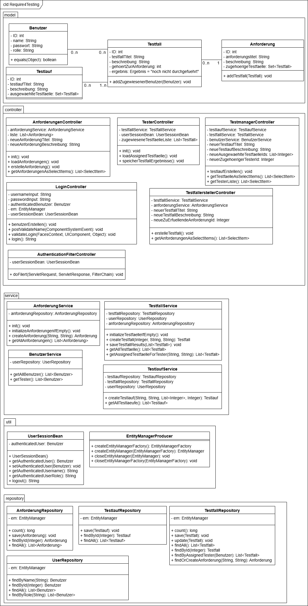
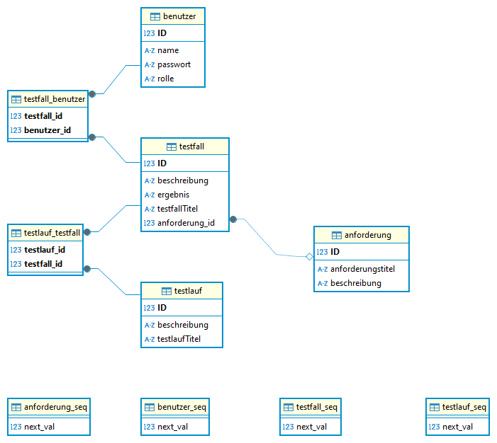
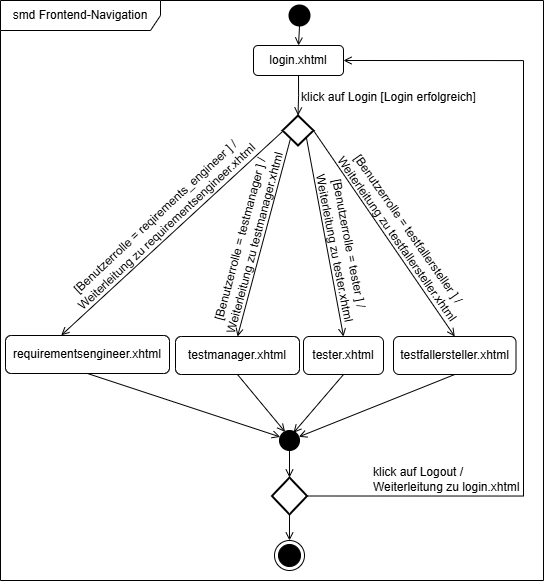
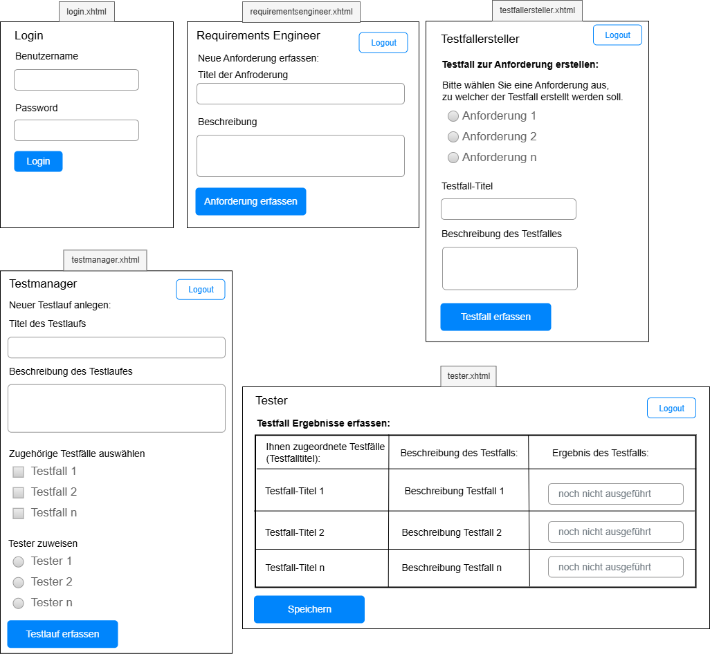

# Testmanagement-Webanwendung für Anforderungen, Testfälle und Testläufe (Jakarta EE)

Mehrbenutzer-Webanwendung zur Verwaltung von **Anforderungen, Testfällen und Testläufen**.
Jede Rolle sieht nur ihre eigene Oberfläche: Anforderungen erfassen, Testfälle ableiten,
Testläufe zusammenstellen und Testern zuweisen, Ergebnisse eintragen.

Entstanden als Studienprojekt (Java EE / CDI, 3. Semester, Arbeitstitel *Require4Testing*), danach
um Konfiguration per Umgebungsvariablen und Docker ergänzt.

## Technik

| Schicht | Technologie |
|---|---|
| Präsentation | JSF (Mojarra), PrimeFaces, XHTML |
| Logik | CDI (Weld), Controller → Service → Repository |
| Persistenz | JPA / Hibernate, **MySQL 8** |
| Laufzeit | Tomcat 10.1, Java 17 |
| Build / Betrieb | Maven, Docker Compose |

## Rollen

| Rolle | Aufgabe |
|---|---|
| Requirements Engineer | Anforderungen anlegen |
| Testfallersteller | Testfälle zu einer Anforderung erstellen |
| Testmanager | Testfälle zu Testläufen bündeln, Tester zuweisen |
| Tester | zugewiesene Testfälle ausführen, Ergebnis speichern |

## Entwurf und Datenmodell

**Schichten und Klassen** (Model, Controller, Service, Repository, Util):



**Datenbankmodell** (MySQL, Zuordnungstabellen für n:m-Beziehungen):



**Navigation nach dem Login** (Weiterleitung je nach Benutzerrolle):



**Wireframes der Seiten:**



## Starten mit Docker (empfohlen)

```bash
cp .env.example .env      # Werte anpassen
docker compose up --build
```

Danach: <http://localhost:8080/login.xhtml>. Beim ersten Start werden in der leeren Datenbank
sieben Demo-Benutzer angelegt (`Admin`, `NameTestmanager`, `Nametester`, …). Ihr gemeinsames
Passwort ist der Wert von `APP_SEED_PASSWORD` aus `.env`.

## Starten ohne Docker

Voraussetzungen: JDK 17, Maven, Tomcat 10.1, MySQL 8.

```powershell
# Umgebungsvariablen für die Datenbank setzen (Defaults siehe EntityManagerProducer)
$env:DB_URL = "jdbc:mysql://localhost:3306/fallstudiedb"
$env:DB_USER = "fallstudie"
$env:DB_PASSWORD = "..."
$env:APP_SEED_PASSWORD = "..."
.\scripts\deploy-war-tomcat.ps1 -TomcatHome "C:\tools\apache-tomcat-10.1.36"
```

## Projektstruktur

```
src/main/java/
  controller/   JSF-Backing-Beans und Login-Filter
  service/      Geschäftslogik
  repository/   JPA-Zugriffe
  model/        Entitäten
  util/         EntityManager-Producer, Session-Bean
src/main/webapp/  XHTML-Seiten, CSS
```
